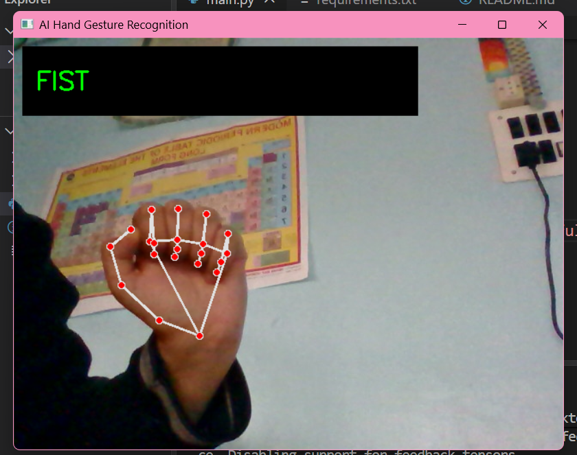
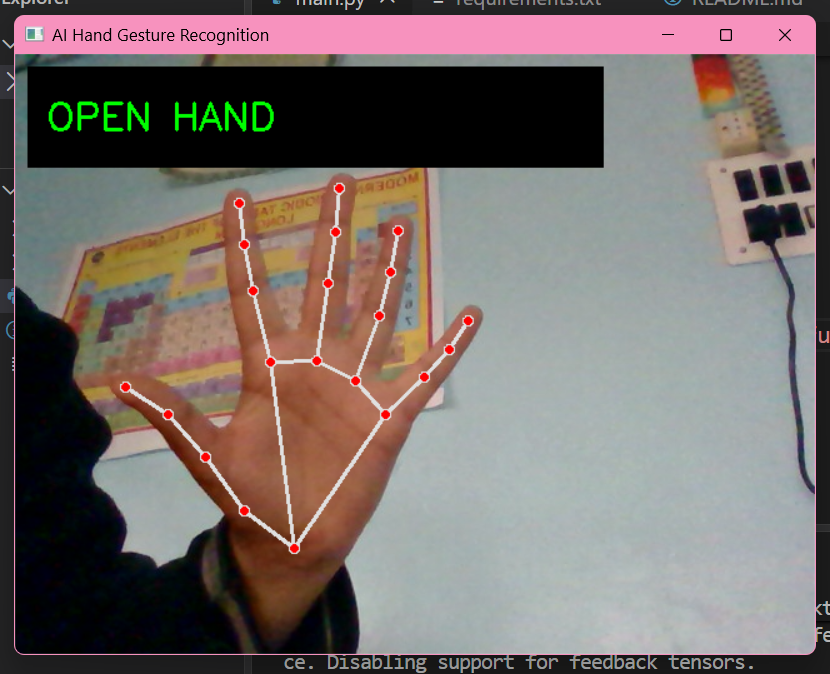
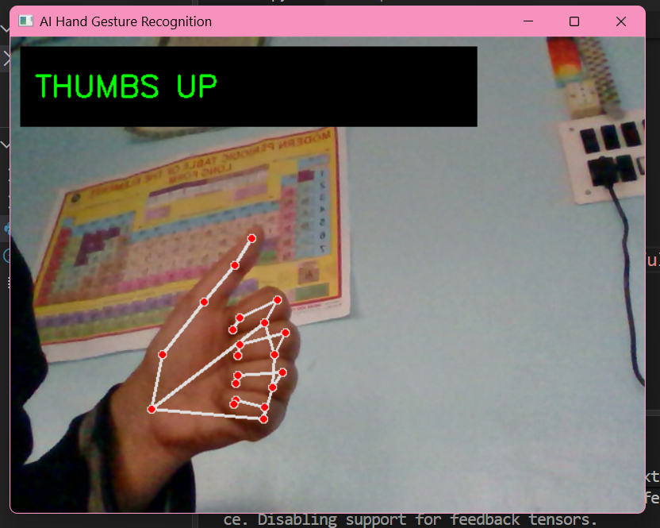
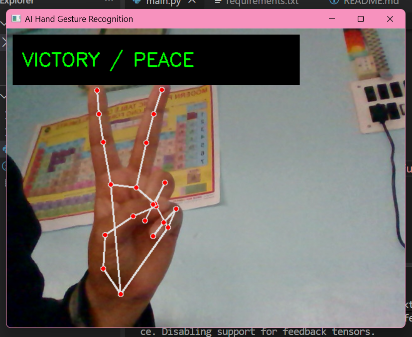

## AI Hand Gesture Recognition

A real-time hand gesture recognition system built using Python, OpenCV, and MediaPipe. The project detects hand landmarks through a webcam and identifies different hand gestures.

## Features

- Real-time hand detection using a webcam.
- Hand landmark tracking using MediaPipe.
- Recognition of four hand gestures:
  - Open Hand
  - Fist
  - Thumbs Up
  - Victory / Peace Sign
- Live gesture labels displayed on the webcam feed.

## Technologies Used

- Python 3.12
- OpenCV 4.11.0
- MediaPipe 0.10.21
- NumPy

## How It Works

The application captures live video from the webcam using OpenCV.

MediaPipe detects 21 landmarks on the hand, tracking the positions of the fingers and palm.

The detected landmark positions are then used to identify hand gestures based on their configurations. The recognized gesture is displayed on the screen in real time.

## Installation

1. Clone the repository:
   
   git clone https://github.com/Falakmuzaffar-AI12/AI-Hand-Gesture-Recognition.git

2. Navigate to the project folder:
   
   cd AI-Hand-Gesture-Recognition

3. Create and activate a virtual environment:
   
   python -m venv venv

4. Install the required dependencies:
   
   pip install -r requirements.txt

Run the Project

Run the following command:

python main.py

The webcam will open and start detecting hand gestures.

Press Q to exit the application.

## Project Structure

## AI-Hand-Gesture-Recognition/
│
├── main.py
├── requirements.txt
├── README.md
├── screenshots/
└── demo/

## screenshots

## Demo

[Watch the demo video](https://github.com/Falakmuzaffar-AI12/AI-Hand-Gesture-Recognition/raw/main/demo/AI%20Hand%20Gesture%20Recognition.mp4)

## Future Improvements

- Improve recognition accuracy under different lighting conditions.
- Add support for more hand gestures.
- Explore gesture-based computer control.
- Improve gesture classification reliability.

## Author

Developed by Falak Muzaffar as an AI and Computer Vision project.
